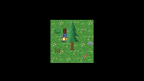

# isometric — the three original 2D problems, on real assets

A 320×180 scene drawn by `tension::2d` from a TensionScript guest: a 6×6 grass
field, a conifer split into two slices, a character made of three layers, and a
camping lantern in front of it. Every pixel comes from
[`../assets/tileset.png`](../assets/tileset.png) — a 384×128 sheet drawn by
[`../assets/build-tileset.mjs`](../assets/build-tileset.mjs), sliced into three
128×128 pages and uploaded through the capability's texture arrays.

This is the worked example the framework layer was specified against. It is not
a framework; it is the five primitives the framework is written on top of, proven
to compose.



*(Back-facing, 2× downscale. The full frames are 320×180 and are regenerated by
`npm start` into `screenshots/`.)*

## The three problems

**Oversized tileset.** The sheet is 384×128 at a 16 px grid: three 128×128
pages, so the scene must sample three array layers in one instanced draw. That
is the point — the adapter's array holds 16, and the test asserts the scene
touches every page it ships. `build.mjs` fails the build if the scene collapses
onto fewer pages than there are, because a per-page pixel probe would still pass
while the multi-atlas claim quietly stopped being true.

141 pieces over 64 cells per page, every page at least 70 % full: the terrain is
three 16-variant autotile sets, the props page holds trees and furniture, the
character page holds four facings × three layers plus 32 icons.

The sheet being *drawn* rather than downloaded is what lets this run on a fresh
clone: it is committed, CC0, and regenerated by a script in this repository. An
earlier version of this example used a third-party pack, which meant the art
could not enter git and the example exited 77 for anyone who did not have it.

**Isometric depth.** Not a projection — the art is top-down 16×16, and there
are no diamond tiles in the sheet. What is isometric here is the
*depth model*: every record carries `sort_key = world y`, larger draws later.
The tree is split into a **crown** (`sort_key` 86, drawn first) and a **trunk**
(118, drawn last), and the character (88) sits between them — so it is hidden by
the trunk and covers the crown. That is the whole reason to slice a tall
sprite, and it is asserted at two pixels:

- at the crown's centre, the character's layer colour is on screen (character
  sorts above the crown);
- at the lantern's centre, the lantern is on screen — its base is 2 px below
  the character's feet, so it sorts above it, even though its pixels reach up
  over the character's legs.

**Modular characters.** Three records at one world position, one `group_id`
(200), ordered by `z`:

| facing | body | hair | backpack |
| --- | --- | --- | --- |
| back | 0 | 1 | **2** |
| front | **2** | 1 | 0 |

The art is the same in both renders; only the z assignment changes. That is the
claim — a composite character is a group plus an ordering, not a sprite sheet of
pre-composed frames. Reversing the assignment moves the visible layer from the
backpack to the body, and the test asserts exactly that colour change.

## Run it

```sh
npm install   # once
npm run build # slice the tileset, compile the guest, pack the volume
npm test      # assert: four probes, both revert levers, three screenshots
npm start     # the same scene in a window, held until you close it
```

**`npm test` is the one that can fail.** It renders every frame offscreen first
— a pixel claim has to be reproducible, and a compositor makes it depend on the
machine — and asserts the probes and the two revert levers.

**`npm start` is one command**: `tension-core --res build/isometric.tns
build/game.wasm --window`. No launcher, no DSO to find, no environment to set;
the renderer is in the binary. `--res` comes *before* the wasm path because it
is a host option, and `--window` comes after it because it is the guest's own
word.

A machine that cannot create a graphics pipeline stops at `set_pipeline` with
`-5`, and `npm test` names that as the driver rather than as a broken scene.

Nothing to fetch. The tileset is committed; to change it, edit
`examples/2d/assets/build-tileset.mjs` and run it — the example rebuilds from
whatever that script draws.

`npm start` then:

1. slices the tileset into three pages, resolves every piece through the
   packer's `LAYOUT`, and computes the probes
   page, writes three IWI blobs (`build.mjs`);
2. compiles the guest (`scripts/build-2d-guest.mjs`);
3. packs the blobs into `build/isometric.tns` with `tension-pack`;
4. runs the guest under `tension-core` with the pak mounted;
5. reads the two frames the guest prints, writes `back.png`, `front.png` and
   `preview.png`, and asserts every claim above.

## What the assertions are

Four claims, six probes, two revert runs — all in `test.mjs`, against colours
`build.mjs` read out of the source art:

```
  back:  composite (125,92,78)  crown (179,123,63)  lantern (242,178,43)
  front: composite (181,121,114) crown (191,139,120) lantern (242,178,43)
  revert composite (body above backpack): probe is (181,121,114) — caught
  revert sort (lantern behind character): probe is (58,58,80) — caught
```

The two revert runs ask the guest for a scene that is wrong in **exactly one**
way — `--swap-composite` flips the z assignment, `--lantern-behind` drops the
lantern's sort key below the character's — and assert the mistake's colour
appears. A revert test that passes because the assertion is broken is worse
than none, so they check for the specific colour the mistake produces rather
than merely "something differs".

## Layout

```
build.mjs                 slice, pick, compose, write IWI + scene table
test.mjs                  run, assert, write screenshots (the gate)
scene.json                the numbers, for the runner (generated)
src/main.ts               the guest: records, pages, two facings
src/bindings.ts           the ten verbs and the record (hand-written)
src/scene.generated.ts    the page/sprite/probe table (generated)
assets/textures/*.iwi     the three pages, 4 MB each (generated, gitignored)
```

Nothing in `src/main.ts` hard-codes a tile coordinate: the picks live in
`scene.generated.ts`, which `build.mjs` writes from the art.

`src/bindings.ts` is hand-written because `tension-2d/include/tension_2d.h` has
no entry in `schema/`, so the codegen tool cannot emit it. That is the same debt
`examples/2d/hello-sprites` carries.

## Two things the guest had to work around

**Textures are read through the resource VFS, not baked in.** The pages are
packed into a `.tns` volume and read at run time through `tension::res`
(`ResFile.readAll`), which is what that capability is for — a guest's data
segment is not where a game's art belongs, whatever its size. At 128×128 the
three pages are 192 KB on disk and the guest holds one at a time, so
`initialMemory` in `asconfig.json` no longer needs to be raised; the setting
stays because the volume path is the one that scales when the art does.

**The adapter had no alpha blending.** The first run of this scene drew the
tree's transparent margins as opaque black rectangles and the character as a
block — the pipeline was created with `enable_blend = false`, and every earlier
test passed because every earlier test drew opaque rectangles. Fixed in
`tension-2d/src/render.cpp` (source-over, straight alpha); the hexdump
assertions of the earlier suites are unaffected because an opaque sprite's blend
is an identity. This example is the reason the defect was found: a sprite
batcher that cannot draw a cut-out is not a sprite batcher.

## What this proves, and what it does not

It proves the primitives compose: multi-atlas across three pages in one draw,
a Y-sorted depth model with a sliced tall sprite, a grouped composite with a
reversible layer order, and a dynamic canvas.

It does **not** prove a framework on its own. The scene is hard-coded in
`main.ts`: the tile picks are constants, the sort keys are literals, the
character's z assignment is an `if`. That was deliberate — this example is the
*specification* the framework was written against.

The framework now exists in the guest SDK (`tension-framework/assembly/2d`: the
`Tileset`, `Composite` and `IsometricWorld` types), and
[`../isometric-framework`](../isometric-framework) rebuilds this scene with it
and asserts the frames are byte-identical to this one. This file stays
hand-written on purpose: it is the control the framework is measured against.

## Running it, and running it in CI

There is no fetch step and no skip: the art is committed, so this example runs
on a fresh clone and in CI. `node test.mjs` is the whole thing, and it exits
non-zero if any probe is wrong.

`npm run test:ci` is the same scene built from generated flat-colour pages
instead: same canvas, same positions, same sort keys, same assertion list, but
the expected colour at every probe is a palette constant rather than a value
read off a PNG. It runs the guest unchanged, because the guest reads its scene
table (`src/scene.generated.ts`) and nothing else.

The difference is what each one can catch. This example catches a mistake in the
art pipeline or the atlas slicing — a tile picked from the wrong page, a
character layer at the wrong offset — because its expectations come from the
pixels. The synthetic one cannot: its pages are drawn from the same constants it
asserts against. Having both means a renderer bug is caught by the cheap test
and an art bug by the real one.

The framework version of the same scene is
[`../isometric-framework`](../isometric-framework): it builds these records from
`Tileset` + `Composite` + `IsometricWorld` and its frames must be byte-identical
to this guest's.
